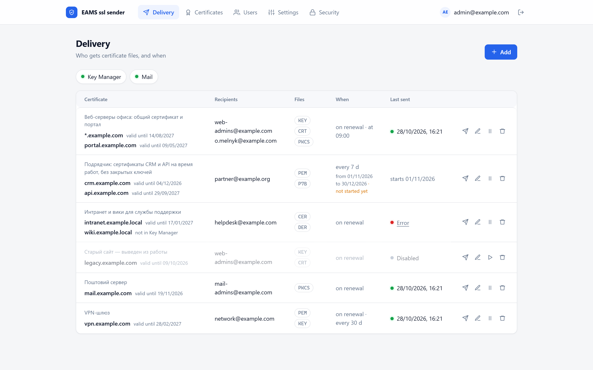
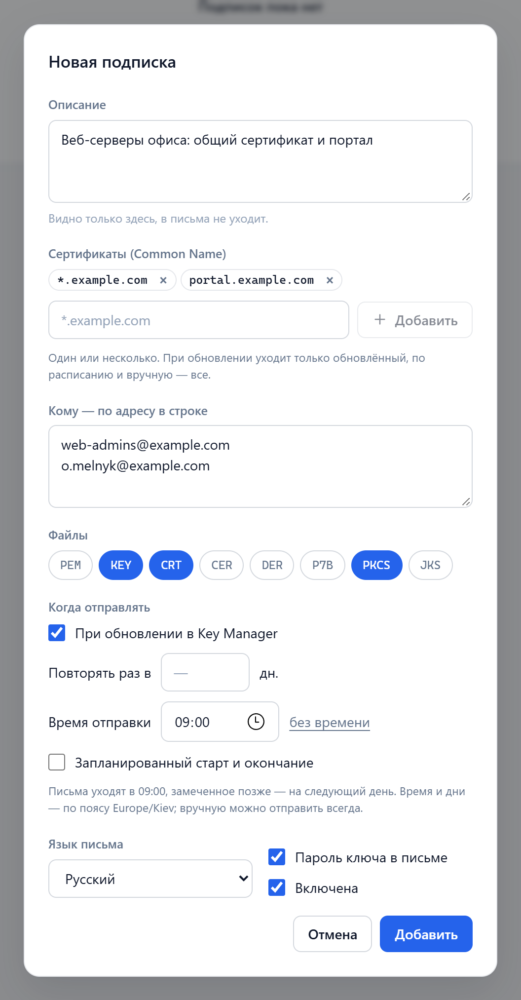
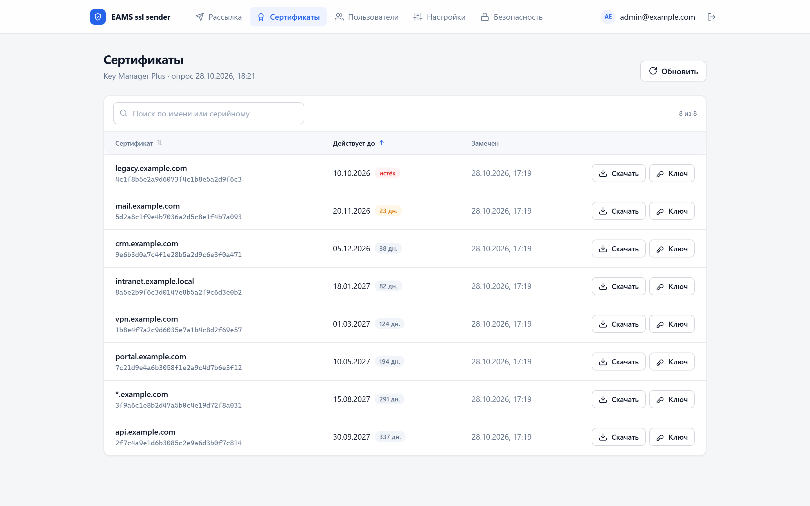
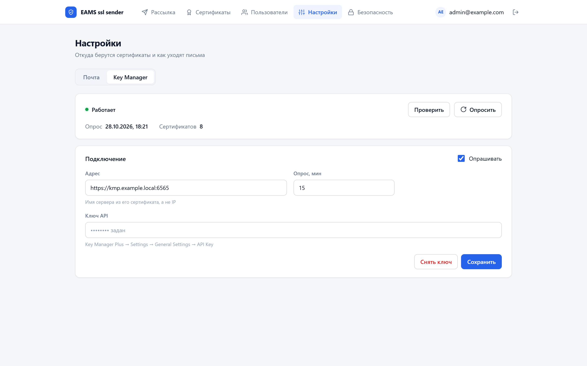
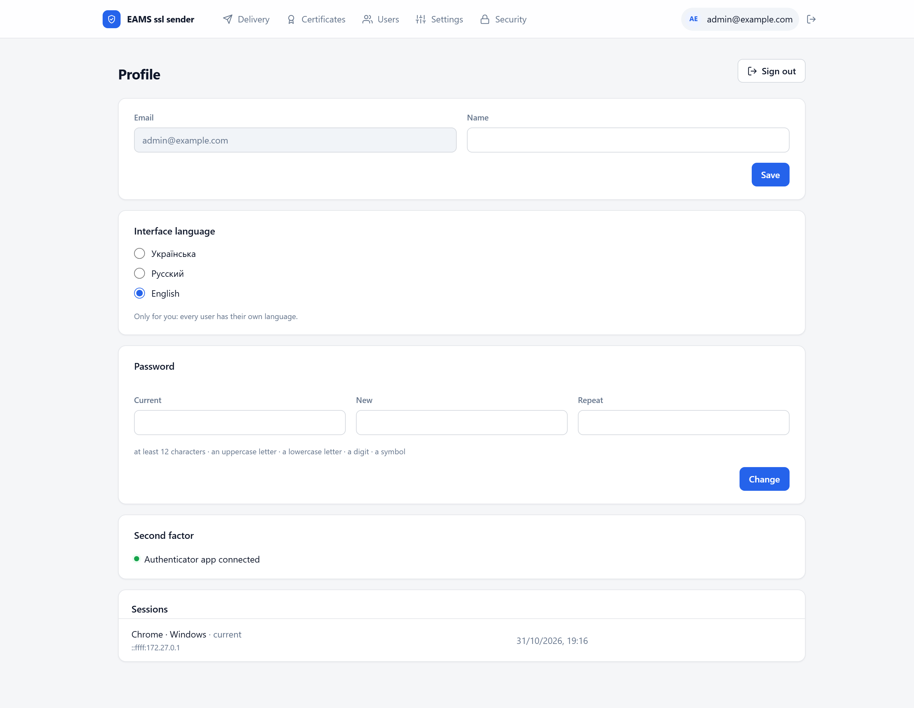
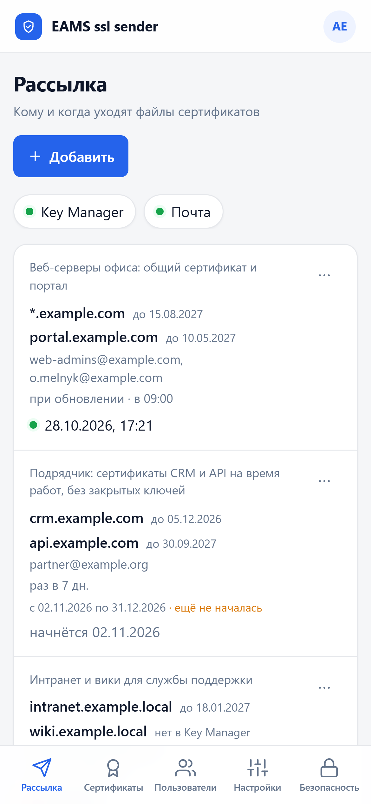
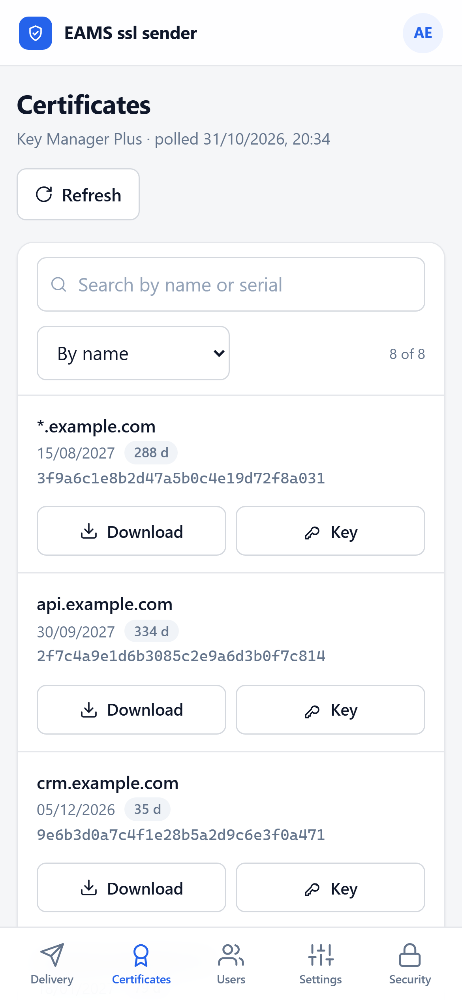
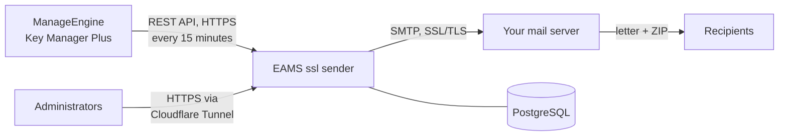
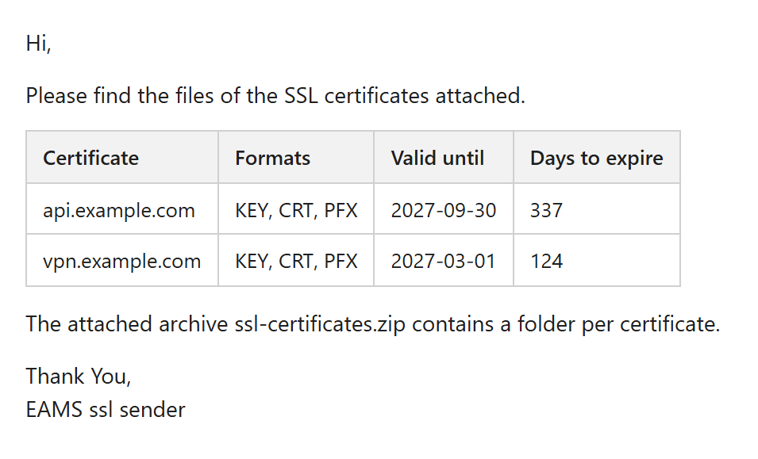

<p align="center">
  
</p>

<h1 align="center">EAMS ssl sender</h1>

<p align="center">
  <b>SSL certificates from ManageEngine Key Manager Plus, delivered by email — automatically.</b><br>
  A certificate is renewed in Key Manager Plus, and the people who install it get its files in their inbox.
</p>

<p align="center">
  <a href="https://github.com/danrey-bilo/eams-ssl-sender/releases/latest"></a>
  <a href="https://hub.docker.com/r/danreero/eams-ssl-sender"></a>
  <a href="LICENSE"></a>
  
  
  
  
  
  
</p>

<p align="center">
  <b>English</b> · <a href="README.ru.md">Русский</a>
</p>

<p align="center">
  
</p>

## Why

Certificates live and get renewed in ManageEngine Key Manager Plus — often automatically, and more
often than ever as certificate lifetimes get shorter. Someone still has to download the new files
and send them to every team that installs them. EAMS ssl sender does that for you:

- it **watches Key Manager Plus** and notices a renewed certificate on its own;
- it **emails the right files to the right people** — only what they need, in the format their
  servers use;
- it keeps **keys and secrets protected** on the way: two-factor sign-in, encryption at rest, strict
  TLS everywhere, an append-only audit log.

## Features

| Feature | What you get |
|---|---|
| **Subscriptions** | Which certificates (1–50), to whom (up to 20 addresses), which files and when. A short description says who the subscription is for. |
| **When to send** | When a certificate is renewed (only the renewed one goes out), every N days (all of them), at a set time of day, within a planned start and end date. **Send now** works at any time. |
| **Files** | Any of the eight Key Manager Plus formats — `PEM`, `CRT`, `CER`, `DER`, `P7B`, `PFX`, `JKS`, `KEY` — plus the key passphrase, packed into one ZIP archive per letter. |
| **Letters** | In English, Ukrainian or Russian. HTML with a certificate table (name, formats, valid until, days left) plus a plain-text part. No links, no images, no tracking. |
| **Web panel** | Certificates with expiry highlighting and sorting, download of any format, viewing the private key, users and invitations, security settings. In English, Ukrainian or Russian — every user picks their own. Works on phones too. |
| **Security** | Password plus authenticator app (TOTP), a fresh code before every sensitive action, AES-256-GCM encryption of secrets, full TLS validation, secrets bound to their server, append-only audit log. |
| **Deployment** | One public Docker image on Docker Hub ([`danreero/eams-ssl-sender`](https://hub.docker.com/r/danreero/eams-ssl-sender)), PostgreSQL and Cloudflare Tunnel — no inbound ports on your server. Portainer-friendly. |

> The web panel speaks English, Ukrainian and Russian: every user picks their own language in
> their **Profile** (initials at the top right). Letters to recipients can be in any of the three, and the
> [user guide](#documentation) is available in English and Russian.

## Screenshots

<table>
  <tr>
    <td width="50%"></td>
    <td width="50%"><br><br></td>
  </tr>
  <tr>
    <td align="center"><sub>A subscription: two certificates, sent on renewal at 09:00, with KEY, CRT and PFX</sub></td>
    <td align="center"><sub>Certificates sorted by expiry · the Key Manager Plus connection</sub></td>
  </tr>
  <tr>
    <td colspan="2" align="center"></td>
  </tr>
  <tr>
    <td colspan="2" align="center"><sub>Profile: every user picks the interface language — English, Ukrainian or Russian</sub></td>
  </tr>
  <tr>
    <td colspan="2" align="center">&nbsp;&nbsp;&nbsp;</td>
  </tr>
  <tr>
    <td colspan="2" align="center"><sub>The panel on a phone: subscriptions and certificates</sub></td>
  </tr>
</table>

## How it works



1. Every 15 minutes (configurable) the service asks Key Manager Plus for the list of SSL
   certificates: Common Name, serial number and expiry date.
2. A renewal is a new serial number for the same Common Name. The service remembers what it has
   already sent to each subscription and notices the new one.
3. For each subscription it decides whether it is time: a certificate was renewed, N days have
   passed, the send time has come, the subscription is within its planned dates.
4. It downloads the selected files and the key passphrase from Key Manager Plus, packs them into
   one ZIP archive and sends a separate letter to each recipient through your SMTP server.
5. The panel shows when and what was sent, and why if something failed.

## What recipients get



One letter per recipient with one attachment. Outlook blocks `.crt`, `.cer` and `.der`
attachments, so the files always come in a ZIP archive:

| Sent | Archive | Inside |
|---|---|---|
| One certificate | `vpn.example.com.zip` | `vpn.example.com.pem`, `vpn.example.com.key`, `passphrase.txt` |
| Several certificates | `ssl-certificates.zip` | a folder per certificate, e.g. `wildcard.example.com/` with `.crt`, `.key`, `.pfx`, `passphrase.txt` |

| Format | File | Contains | Private key | Typical use |
|---|---|---|---|---|
| PEM | `.pem` | Certificate, often with the intermediate chain (text) | No | nginx, Apache, HAProxy, Linux, appliances |
| CRT / CER | `.crt` / `.cer` | Certificate | No | Apache, nginx; Windows trust stores |
| DER | `.der` | Certificate, binary | No | Java, Android, some appliances |
| P7B | `.p7b` | PKCS#7: certificate with its chain | No | Windows / IIS chain install, Java |
| PKCS | `.pfx` | PKCS#12: certificate, chain and private key under a password | **Yes** | IIS, Exchange, Windows, Azure |
| JKS | `.jks` | Java KeyStore | **Yes** | Tomcat and Java applications |
| KEY | `.key` | Private key only (often encrypted) | **Yes** | nginx, Apache, HAProxy — with CRT/PEM |
| — | `passphrase.txt` | The key passphrase from Key Manager Plus | — | Opening an encrypted KEY, PFX or JKS |

> **A letter with KEY, PFX or JKS carries a private key.** Send it only to the people who install
> the certificate on a server. Partners and clients who only need to trust a certificate should get
> CRT, CER, DER or P7B.

## Requirements

| What | Why |
|---|---|
| A Linux server with Docker Engine and Compose v2, or Portainer | The service, its database and the tunnel run in containers |
| A domain in Cloudflare | Publishing the panel through Cloudflare Tunnel (or your own reverse proxy with TLS) |
| A mailbox with SMTP access | Letters are sent from it |
| Key Manager Plus 7.1.1+ with a certificate issued by a certificate authority, and its REST API key | Where the certificates come from |

The server needs outbound access to Cloudflare, your SMTP server and Key Manager Plus (port 6565).
No inbound ports are needed.

## Installation with Portainer

The **`email-ssl-sender-vX.Y.Z.zip`** archive from [Releases](../../releases) has everything for
the stack: `docker-compose.yml`, `.env.example` with hints and a step-by-step README. The stack pulls
the public image [`danreero/eams-ssl-sender`](https://hub.docker.com/r/danreero/eams-ssl-sender)
from Docker Hub by itself; the `email-ssl-sender-image-vX.Y.Z.tar` in the archive is only for
servers without internet access (**Images → Import**).

1. Fill in `.env.example`: `SENDER_MASTER_KEK` (`openssl rand -base64 32`), `POSTGRES_PASSWORD` and
   `SENDER_APP_PASSWORD` (`openssl rand -hex 24`, different ones), `CLOUDFLARE_TUNNEL_TOKEN`,
   `SENDER_INIT_ADMIN_EMAIL` and `SENDER_INIT_ADMIN_PASSWORD`.
2. **Stacks → Add stack** → name `email-ssl-sender` → **Upload** → `docker-compose.yml` →
   **Load variables from .env file** → **Deploy the stack**.
3. In Cloudflare, for the tunnel: **Public Hostname** → `HTTP` `api:8001`. Turn on Cloudflare Access
   (see below).
4. Sign in as the administrator and connect an authenticator app; then clear
   `SENDER_INIT_ADMIN_PASSWORD` in the stack variables → **Update the stack**.

The `migrate` service applies database migrations on every deployment; it also creates the first
administrator and can reset access (`SENDER_RESET_ACCESS_*`, once per address + password pair),
because Portainer has no console. To update: with `SENDER_IMAGE=danreero/eams-ssl-sender:latest`,
**Update the stack** with **Re-pull image** turned on; with a pinned version, set the new
`SENDER_IMAGE` → **Update the stack**.

> Secrets in Portainer are stack variables: access to Portainer equals access to them. Keep a copy
> of `SENDER_MASTER_KEK` somewhere safe and separate.

## Installation from the command line

With secrets in files, on a server with Docker Compose v2.

**1. Files.** Download `email-ssl-sender-cli-vX.Y.Z.zip` from [Releases](../../releases) and unpack
it on the server.

```bash
unzip email-ssl-sender-cli-v*.zip && cd email-ssl-sender
```

**2. Image.** The public image from Docker Hub (without internet access — `docker load -i
email-ssl-sender-image-vX.Y.Z.tar` from the main release archive):

```bash
docker pull danreero/eams-ssl-sender:latest
```

**3. Secrets.** The script creates the master encryption key and the database passwords in
`secrets/`. Existing files are never overwritten.

```bash
./scripts/gen-secrets.sh
```

> Keep a copy of `secrets/sender_master_kek` in a safe place, **separate** from database backups.
> Encrypted data cannot be opened without it.

**4. Cloudflare Tunnel.** In Cloudflare: **Zero Trust → Networks → Tunnels → Create a tunnel**
(type Cloudflared). Copy the token from the install command — the long string after `--token` —
and paste it into the script (input is hidden; the token goes to a secret file, not to `.env`):

```bash
cp .env.example .env
./scripts/set-tunnel-token.sh
```

Then **Public Hostname → Add**: your panel address (for example `certs.example.com`), service type
`HTTP`, URL `api:8001`. `api:8001` is the service name inside Docker, not your server's address;
Cloudflare provides HTTPS for the browser.

**5. Cloudflare Access — employees only.** Without it the sign-in page is open to the whole
internet. **Zero Trust → Access → Applications → Add an application → Self-hosted**: your panel
domain, session duration `8 hours`, policy `Allow` for `Emails ending in @example.com` or a group
from your corporate identity provider. The password and the authenticator code remain the second
line of defence.

**6. Database and the first administrator.** The password is asked with hidden input.

```bash
docker compose run --rm migrate
docker compose run --rm api create-superadmin --email admin@example.com
```

**7. Start and check.**

```bash
docker compose up -d
docker compose ps
curl -s http://127.0.0.1:8001/api/ready
```

Open `https://certs.example.com` and sign in.

<details>
<summary>Without Cloudflare — your own reverse proxy</summary>

Remove the tunnel lines from `.env`. The service listens on `127.0.0.1:8001` only; publish it via
nginx, Caddy or Traefik **with HTTPS** (the browser will not keep the session over plain HTTP).
Example for Caddy:

```
certs.example.com {
    reverse_proxy 127.0.0.1:8001
}
```

For sign-in rate limits to count per user address, set the address the proxy comes from (usually
the Docker network gateway) in `.env`:

```
SENDER_TRUSTED_PROXY_NETWORKS=172.18.0.1/32
```

</details>

## Setting up in the panel

1. **Sign in** with the email and password from installation, then scan the QR code with an
   authenticator app (Google Authenticator, Microsoft Authenticator, Aegis, 1Password).
2. **Настройки → Почта** (Settings → Mail): your SMTP server, port and security (`465` / `SSL/TLS`
   or `587` / `STARTTLS`), login, password, sender address and the panel address. Save and send a
   **test letter**.
3. **Настройки → Key Manager** (Settings → Key Manager): the address `https://server-name:6565` —
   the name from the server's certificate, not an IP — and the API key from Key Manager Plus
   (**Settings → General Settings → API Key → Generate**). Save and press **Проверить** (Check):
   the panel shows how many certificates it sees.
4. **Рассылка → Добавить** (Delivery → Add): certificates, recipients, files and when to send.
5. **Пользователи → Пригласить** (Users → Invite): invite colleagues; each sets their own password
   and authenticator.

The full walkthrough with screenshots is in the [user guide](#documentation).

## Security

- **Sign-in only with a second factor** (TOTP). An emailed code cannot replace it, so a hijacked
  mailbox gives no access. Rate limits per address and account, lockout after a series of failures.
- **A fresh code before sensitive actions**: downloading certificates and keys, any change of
  settings, subscriptions or users, test letters, password changes — only with a code confirmed in
  this session within the last 10 minutes. A stolen session without the phone gets no keys.
- **Closed by default**: without signing in only the sign-in pages and the health check are
  reachable.
- **Secrets are encrypted** with AES-256-GCM under a master key from a file: the SMTP password, the
  Key Manager Plus API key, TOTP secrets, queued letters. Private keys in attachments are wiped from
  the database right after sending.
- **TLS is always validated**: SMTP and Key Manager Plus — full chain, host name and revocation
  checks. Validation cannot be turned off.
- **The SMTP password and the API key are bound to their server**: after changing the address they
  must be entered again, so a signed-in attacker cannot redirect them to their own server.
- **Letters with keys don't linger**: deleting a subscription or a recipient cancels unsent
  letters; a letter not sent within 24 hours loses its attachments.
- **Container**: non-root, read-only file system, no Linux capabilities, no published ports.
- **Database**: the service uses a role that can only read and write rows; the schema owner's
  password is known only to the `migrate` service. The database has no internet access.
- **Append-only audit log** in the database, hash-chained: who signed in, what changed, who
  downloaded certificates or viewed private keys, who was denied.

Recommended: Cloudflare Access in front of the panel, a dedicated mailbox for sending, a dedicated
Key Manager Plus account for the API key, a pinned image version in `.env`, and sending KEY/PFX only
to the people who need the private key.

## Updating

```bash
./scripts/gen-secrets.sh          # creates missing secret files, never touches existing ones
docker compose pull api           # the new image from Docker Hub (SENDER_IMAGE in .env)
docker compose run --rm migrate
docker compose up -d
```

`migrate` is required after every update: the service does not start on an outdated schema. Take a
database backup first. Version-specific notes are in the [changelog](CHANGELOG.md) (in Russian).

## Backups and access recovery

**Database backup** (keep the master key separately):

```bash
mkdir -p backups && docker compose exec -T postgres pg_dump -U sender sender > backups/sender.sql
```

**Lost access** (forgotten password, lost phone) — one command on the server sets a new password
(asked twice, hidden), removes the second factor and the lockout, and closes all sessions:

```bash
./scripts/reset-access.sh admin@example.com
```

## Documentation

| Document | Language |
|---|---|
| [User guide](<docs/User Guide EAMS ssl sender.docx>) — sign-in, mail and Key Manager Plus, certificates, delivery setup, letters and file formats, users, security, FAQ (Word, with screenshots) | English |
| [Руководство пользователя](<docs/Инструкция пользователя EAMS ssl sender.docx>) — то же по-русски | Russian |
| [Reference](docs/REFERENCE.md) — architecture, REST API, all settings, master key rotation, development | Russian |
| [Key Manager Plus API](docs/KEYMANAGER-API.md) — which REST API methods are called and what is taken from them | Russian |
| [Portainer installation](deploy/portainer/README.md) | Russian |
| [Changelog](CHANGELOG.md) | Russian |

## License

EAMS ssl sender is **free to use**, but it is **not open source**. See [LICENSE](LICENSE)
([Russian translation](LICENSE.ru.md)).

| ✅ Allowed | ❌ Not allowed without written permission |
|---|---|
| Install and run the official builds for any purpose, including inside your company, on any number of servers, free of charge | Copying the source code, in whole or in part |
| Back up the official builds and adapt the shipped deployment files to run the service | Modifying the code, building or running modified versions |
| View the source code to evaluate it and review its security | Redistributing, selling or sublicensing the code or the builds |
| | Using the code to develop or train other software, services or models |

Third-party open-source components inside the builds remain under their own licenses.

## Contributing

Code contributions are not accepted. Bug reports and suggestions are welcome in
[Issues](../../issues). Please report security problems privately — see [SECURITY.md](SECURITY.md).
