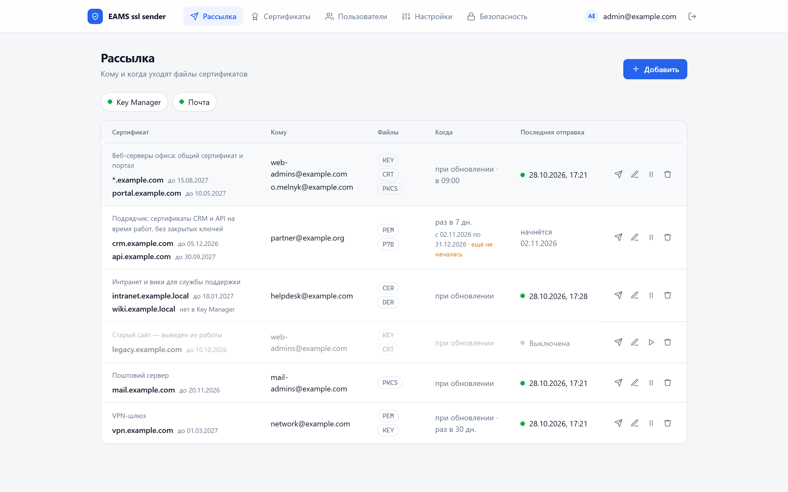
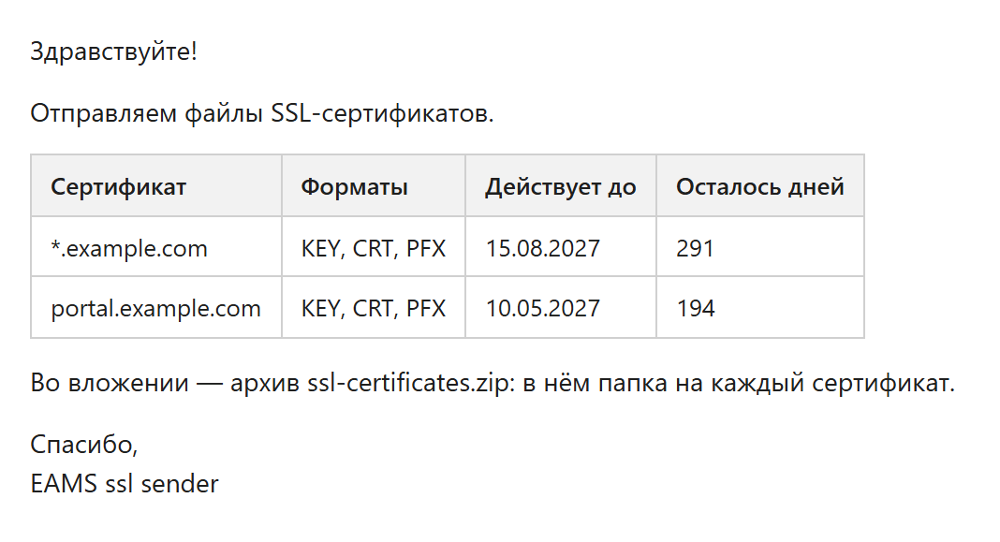

<p align="center">
  
</p>

<h1 align="center">EAMS ssl sender</h1>

<p align="center">
  <b>SSL-сертификаты из ManageEngine Key Manager Plus — сами приходят на почту.</b><br>
  Сертификат обновился в Key Manager Plus — те, кто его ставит, получают файлы письмом.
</p>

<p align="center">
  <a href="https://github.com/danrey-bilo/eams-ssl-sender/releases/latest"></a>
  <a href="https://hub.docker.com/r/danreero/eams-ssl-sender"></a>
  <a href="LICENSE.ru.md"></a>
  
  
  
  
  
  
</p>

<p align="center">
  <a href="README.md">English</a> · <b>Русский</b>
</p>

<p align="center">
  
</p>

- **Подписки:** какие сертификаты (от 1 до 50), кому, какие файлы (`PEM`, `KEY`, `CRT`, `PFX`,
  `JKS`…), когда — при обновлении (уходит только обновлённый), раз в N дней (уходят все), в заданное
  время, в запланированный период. **Отправить сейчас** — в любой момент.
- **Веб-панель** с входом по паролю и коду из приложения-аутентификатора; на украинском, русском или
  английском — язык каждый выбирает себе сам в своём **Профиле**; работает и с телефона.
- **Почта через ваш SMTP** по SSL/TLS, очередь с повторами; письма на русском, украинском или
  английском.
- **Docker:** один образ сервиса, PostgreSQL и Cloudflare Tunnel — без открытых портов на сервере.

Письмо получателю — таблица сертификатов и файлы одним архивом ZIP (Outlook блокирует вложения
`.crt`, `.cer`, `.der`):



Подробное руководство со скриншотами — [Инструкция пользователя](<docs/Инструкция пользователя EAMS ssl sender.docx>)
(Word); на английском — [User Guide](<docs/User Guide EAMS ssl sender.docx>).

## Содержание

1. [Требования](#требования)
2. [Установка через Portainer](#установка-через-portainer)
3. [Установка из командной строки](#установка)
4. [Настройка в панели](#настройка-в-панели)
5. [Безопасность](#безопасность)
6. [Обновление](#обновление)
7. [Резервные копии и восстановление доступа](#резервные-копии-и-восстановление-доступа)
8. [Справочник](#справочник)
9. [Лицензия](#лицензия)

## Требования

| Что | Зачем |
|---|---|
| Сервер Linux с Docker Engine и Compose v2 или Portainer | Сервис, база и туннель в контейнерах |
| Домен в Cloudflare | Публикация панели через Cloudflare Tunnel (или свой обратный прокси с TLS) |
| Почтовый ящик с доступом по SMTP | С него уходят письма |
| Key Manager Plus 7.1.1+ с сертификатом удостоверяющего центра и ключ его REST API | Откуда берутся сертификаты |

Серверу нужен исходящий доступ к Cloudflare, SMTP-серверу и Key Manager Plus (порт 6565).
Входящие порты не нужны.

## Установка через Portainer

Архив **`email-ssl-sender-vX.Y.Z.zip`** со страницы [Releases](../../releases) — всё для стека. Образ
стек скачает сам: открытый [`danreero/eams-ssl-sender`](https://hub.docker.com/r/danreero/eams-ssl-sender)
в Docker Hub.

| Файл | Что это |
|---|---|
| `docker-compose.yml` | Стек: база, миграции, сервис, Cloudflare Tunnel |
| `.env.example` | Переменные: секреты, токен туннеля, первый администратор — с подсказками |
| `email-ssl-sender-image-vX.Y.Z.tar` | Образ сервиса — только для сервера без интернета (**Images → Import**) |
| `README.md` | Эти шаги подробно |

1. Заполните `.env.example`: `SENDER_MASTER_KEK` (`openssl rand -base64 32`), `POSTGRES_PASSWORD` и
   `SENDER_APP_PASSWORD` (`openssl rand -hex 24`, разные), `CLOUDFLARE_TUNNEL_TOKEN`,
   `SENDER_INIT_ADMIN_EMAIL` и `SENDER_INIT_ADMIN_PASSWORD`.
2. **Stacks → Add stack** → Name `email-ssl-sender` → **Upload** → `docker-compose.yml` →
   **Load variables from .env file** → **Deploy the stack**.
3. В Cloudflare у туннеля: **Public Hostname** → `HTTP` `api:8001`. Включите Cloudflare Access
   (шаг 5 ниже).
4. Войдите администратором, подключите приложение-аутентификатор; в переменных стека очистите
   `SENDER_INIT_ADMIN_PASSWORD` → **Update the stack**.

Миграции выполняет служба `migrate` при каждом развёртывании — она же заводит первого
администратора и сбрасывает доступ (`SENDER_RESET_ACCESS_*` — один раз на пару «адрес + пароль»),
потому что консоли в Portainer нет.
Обновление: при `SENDER_IMAGE=danreero/eams-ssl-sender:latest` — **Update the stack** с **Re-pull
image**; при закреплённой версии — новый `SENDER_IMAGE` → **Update the stack**. Подробно —
[deploy/portainer/README.md](deploy/portainer/README.md).

> ⚠ Секреты в Portainer хранятся переменными стека: доступ к Portainer равен доступу к ним.
> Сохраните копию `SENDER_MASTER_KEK` отдельно.

## Установка

Из командной строки, с секретами в файлах (Docker Compose v2 на сервере).

**1. Файлы установки.** Скачайте `email-ssl-sender-cli-vX.Y.Z.zip` со страницы
[Releases](../../releases) и распакуйте на сервере.

```bash
unzip email-ssl-sender-cli-v*.zip && cd email-ssl-sender
```

**2. Образ.** Открытый образ из Docker Hub (без интернета — `docker load -i
email-ssl-sender-image-vX.Y.Z.tar` из главного архива релиза):

```bash
docker pull danreero/eams-ssl-sender:latest
```

**3. Секреты.** Скрипт создаёт мастер-ключ шифрования и пароль базы в `secrets/`. Существующие
файлы не перезаписывает.

```bash
./scripts/gen-secrets.sh
```

> ⚠ Сохраните копию `secrets/sender_master_kek` в надёжном месте **отдельно** от копий базы.
> Без него зашифрованные данные не открыть.

**4. Cloudflare Tunnel.** В Cloudflare: **Zero Trust → Networks → Tunnels → Create a tunnel**
(тип Cloudflared). Скопируйте токен из команды установки — длинную строку после `--token` — и
вставьте его в скрипт (ввод скрыт, токен ложится в файл секрета, а не в `.env`):

```bash
cp .env.example .env
./scripts/set-tunnel-token.sh
```

Затем в туннеле **Public Hostname → Add**:

| Поле | Значение |
|---|---|
| Subdomain / Domain | адрес панели, например `certs.example.com` |
| Service → Type | `HTTP` |
| Service → URL | `api:8001` |

`api:8001` — имя сервиса внутри Docker, а не адрес сервера. HTTPS для браузера даёт Cloudflare.

**5. Cloudflare Access — доступ только сотрудникам.** Без него страница входа открыта всему
интернету. **Zero Trust → Access → Applications → Add an application → Self-hosted**:

| Поле | Значение |
|---|---|
| Application domain | адрес панели, например `certs.example.com` |
| Session duration | `8 hours` |
| Policy → Action | `Allow` |
| Policy → Include | `Emails ending in` `@example.com` или группа из корпоративного IdP |

Теперь до панели дойдёт только тот, кто подтвердил корпоративную почту. Пароль и код из
приложения по-прежнему нужны — это второй рубеж.

**6. База и первый администратор.** Пароль спрашивается скрытым вводом.

```bash
docker compose run --rm migrate
docker compose run --rm api create-superadmin --email admin@example.com
```

`migrate` накатывает схему и заводит роль базы `sender_app`, которой ходит сервис: она только
читает и пишет строки. Пароль владельца схемы есть только у службы `migrate`.

**7. Запуск.**

```bash
docker compose up -d
```

**8. Проверка.**

```bash
docker compose ps
curl -s http://127.0.0.1:8001/api/ready
docker compose logs cloudflared | grep -m1 'Registered tunnel connection'
```

Откройте `https://certs.example.com` и войдите.

<details>
<summary>Без Cloudflare — свой обратный прокси</summary>

Уберите из `.env` строки туннеля. Сервис слушает только `127.0.0.1:8001`; опубликуйте его через
nginx, Caddy или Traefik **с HTTPS** (по HTTP браузер не сохранит сессию). Пример Caddy:

```
certs.example.com {
    reverse_proxy 127.0.0.1:8001
}
```

Чтобы ограничение попыток входа считалось по адресу пользователя, укажите в `.env` адрес, с
которого прокси приходит в контейнер (обычно шлюз сети Docker):

```
SENDER_TRUSTED_PROXY_NETWORKS=172.18.0.1/32
```

</details>

## Настройка в панели

Вкладки: **Рассылка**, **Сертификаты**, **Пользователи**, **Настройки**, **Безопасность**; профиль —
инициалы справа вверху.

**1. Вход.** Почта и пароль из шага 6, затем QR-код для приложения-аутентификатора (Google
Authenticator, Microsoft Authenticator, Aegis, 1Password). Дальше вход — пароль и шестизначный код
из приложения. Код на почту заменить приложение не может: потерян телефон — второй фактор
снимает другой администратор или команда из раздела [восстановления](#резервные-копии-и-восстановление-доступа).

**2. Настройки → Почта** — поля SMTP вашего ящика:

| Поле | Пример | |
|---|---|---|
| Сервер | `mail.example.com` | только имя, без `https://` |
| Порт / Защита | `465` / `SSL/TLS` | или `587` / `STARTTLS` |
| Логин, пароль | `certs@example.com` | пароль хранится зашифрованным |
| Адрес отправителя | `certs@example.com` | |
| Адрес панели | `https://certs.example.com` | для ссылок в приглашениях |

Сохраните и нажмите **Тестовое письмо**. При отказе панель покажет ответ почтового сервера.
Пароль привязан к серверу, порту, защите и логину: сменили что-то из них — введите пароль заново.

**3. Настройки → Key Manager.**

- **Ключ API:** в Key Manager Plus — **Settings → General Settings → API Key → Generate**.
- **Адрес:** `https://имя-сервера:6565`. Имя должно совпадать с сертификатом Key Manager Plus
  (не IP). Сертификат Key Manager Plus должен быть выдан удостоверяющим центром —
  самоподписанный сервис не принимает (с 2.5).

Нажмите **Сохранить**, затем **Проверить**: панель покажет, сколько сертификатов видно.
Ключ привязан к адресу: сменили адрес — введите ключ заново.

**4. Рассылка → Добавить:** один или несколько сертификатов, адреса получателей, файлы, когда
слать — при обновлении (уходит только обновлённый сертификат) и/или раз в N дней (уходят все).
Хотя бы один из двух способов обязателен. Первое письмо уходит сразу; **Отправить сейчас** шлёт все
сертификаты подписки.

**Время отправки** — во сколько уходят письма опроса, например 09:00. Обновление, замеченное после
этого времени, уйдёт на следующий день в то же время. Пустое время — письма уходят сразу, как опрос
заметит, что пора.

**Запланированный старт и окончание** — галочка и два дня: с какого и по какой день (оба
включительно) опрос рассылает подписку. До первого дня и после последнего он её не шлёт; в первый
день уходят все ещё не отправленные сертификаты. Можно задать только начало или только окончание.
Дни и время — по часовому поясу браузера, в котором подписку завели. **Отправить сейчас** работает
всегда — и вне периода.

**Описание** — заметка для себя: для кого и зачем эта рассылка. Видно только в панели, в письма не
уходит. В списке подписка показывает описание, все свои сертификаты со сроком каждого и всех
получателей; сертификат, которого нет в Key Manager Plus, помечен «нет в Key Manager».

Письмо — таблица сертификатов, как в уведомлении Key Manager Plus (сертификат, форматы, действует
до, осталось дней), и архив с файлами: несколько сертификатов — папка на каждый.

**5. Сертификаты** — всё, что видит Key Manager Plus, со сроком действия; истекающие подсвечены.
Щелчок по заголовку **Действует до** сортирует по сроку: сначала истекающие, повторный щелчок — сначала
дальние; **Сертификат** — снова по имени. На телефоне порядок выбирается списком над сертификатами.
Выбор браузер запоминает.
**Скачать** — файл в нужном формате (PEM, CRT, PFX, KEY и другие). **Ключ** — показать закрытый
ключ и его пароль, скопировать или сохранить.

**6. Пользователи** — пригласить коллег. Приглашение уходит письмом; пароль и аутентификатор
человек настраивает сам.

**7. Безопасность** — блокировка после неудачных входов, время сессии, требования к паролю,
срок ссылок и окно подтверждения кодом.

**Код перед важными действиями.** Скачивание сертификата, показ ключа, изменения настроек,
безопасности, подписок и пользователей требуют свежего кода из приложения. Панель сама спросит
его и повторит действие; после кода (и после входа) 10 минут код не спрашивается. Окно
задаётся во вкладке «Безопасность».

**Телефон.** Вид выбирается по режиму браузера, а не по размеру экрана: Chrome на телефоне —
мобильный вид с вкладками внизу; «Версия для ПК» — компьютерный вид.

## Безопасность

**Встроено:**

- **Вход только с вторым фактором** (TOTP). Код письмом его не заменяет: захваченный
  почтовый ящик не даёт входа. Ограничение попыток по адресу и учётной записи, блокировка после
  серии неудач, не больше 5 кодов на одну попытку входа.
- **Свежий код перед важными действиями:** выгрузка сертификатов и ключей, любые изменения
  настроек, подписок и пользователей, проверочное письмо, смена своего пароля — только с кодом,
  подтверждённым в этой сессии за последние 10 минут. Панель сама спросит код. Угнанная сессия без
  телефона ключей не получит.
- **Всё закрыто по умолчанию:** без входа доступны только страницы входа и проверка здоровья.
- **Секреты зашифрованы** AES-256-GCM под мастер-ключом из файла: пароль SMTP, ключ API Key
  Manager Plus, секреты TOTP, письма в очереди. Закрытые ключи во вложениях стираются из базы
  сразу после отправки.
- **TLS проверяется всегда:** SMTP и Key Manager Plus — полная проверка цепочки, имени и отзыва.
  Отключить проверку нельзя, самоподписанный сертификат Key Manager Plus не принимается.
- **Пароль SMTP и ключ API привязаны к адресу сервера.** Вошедший не может перенаправить их на
  свой сервер: после смены адреса секрет нужно ввести заново. Пароль по незашифрованному
  соединению не отправляется.
- **Письма с ключами не залёживаются:** удалили подписку или получателя — неотправленные письма
  отменяются; письмо, не ушедшее за 24 часа, теряет вложения.
- **Контейнер:** не root, файловая система только для чтения, без Linux capabilities. Наружу
  ни одного порта: сервис слушает `127.0.0.1`, публикация — исходящим туннелем.
- **База:** сервис ходит ролью `sender_app` — только чтение и запись строк, без права менять
  схему и без прав суперпользователя. Пароль владельца схемы есть только у службы `migrate`.
  У самой базы нет выхода в интернет.
- **Панель:** строгая CSP, без внешних скриптов, запрет встраивания во фрейм, сессия в куке
  `HttpOnly; Secure; SameSite=Strict`.
- **Журнал действий в базе** (таблица `audit_log`): кто вошёл, что изменил в настройках, учётных
  записях и подписках, кто выгружал сертификаты и смотрел закрытые ключи, кому отказано в доступе.
  Только дописывается — изменить или стереть запись не может даже владелец базы; строки сцеплены
  хешами, проверка — `docker compose run --rm api verify-audit-chain`. Читать — `GET /api/audit`.
  Каждое событие — ещё и строка `audit` в логах сервиса (`docker compose logs api | grep audit`).
- **Закрытый ключ не уходит по почте без шифрования** (`mail.smtp_security = none`), а сужение
  подписки (убрали `KEY`, пароль ключа, отключили) отменяет письма, ещё стоящие в очереди.

**Рекомендуется для корпоративной установки:**

1. **Cloudflare Access перед панелью.** Zero Trust → Access → Applications → Add → Self-hosted,
   домен панели, политика Allow — только адреса вашей компании (или группа из корпоративного
   IdP). Тогда до страницы входа дойдут только сотрудники.
2. **Отдельный ящик для рассылки** с доступом только по SMTP и надёжным паролем.
3. **Ключ API Key Manager Plus** — от отдельной служебной учётной записи.
4. **Закреплённая версия образа** в `.env`: `SENDER_IMAGE=danreero/eams-ssl-sender:X.Y.Z`.
5. **Шлите `KEY`/`PFX` только тем, кому нужен закрытый ключ.** Письмо с ключом — секрет.

## Обновление

```bash
./scripts/gen-secrets.sh          # создаст недостающие файлы секретов, существующие не тронет
docker compose pull api           # новый образ из Docker Hub (SENDER_IMAGE в .env)
docker compose run --rm migrate
docker compose up -d
```

`migrate` обязателен после каждого обновления: на старой схеме базы сервис не стартует.

### Обновление до 2.1

Подписки переходят на список сертификатов сами: каждая получает список из одного своего
сертификата, отправленное засчитывается — повторной рассылки нет. Перед обновлением — копия базы
(«Резервные копии»): откат на 2.0 возможен только из неё.

### Обновление до 2.2

Журнал действий переезжает в базу (таблица `audit_log`), `migrate` создаёт её сам. Сеть туннеля
получает закреплённые адреса: cloudflared — `172.31.250.2`, API — `172.31.250.3`. Если вы меняли
подсеть `SENDER_TUNNEL_SUBNET`, задайте в `.env` и `SENDER_TUNNEL_PROXY_IP`, `SENDER_TUNNEL_API_IP`
внутри неё. Перед `up -d` остановите службы, чтобы адреса не столкнулись со старыми контейнерами:

```bash
docker compose stop api cloudflared
```

### Обновление до 2.0

Версия 2.0 перешла на модули EAMS (учётные записи, сессии, настройки, почта — подробно в
[docs/REFERENCE.md](docs/REFERENCE.md#модули-eams-подмодулями)). Данные переносятся командой
`migrate` сами, но шаг необратим без копии — **сначала копия базы**:

```bash
mkdir -p backups && docker compose exec -T postgres pg_dump -U sender sender > backups/sender-before-2.0.sql
```

Затем обычные `pull`, `run --rm migrate`, `up -d`. Что делает `migrate` при переходе:

- схема базы доводится до схемы модулей (мост `ModulesBridge`); каждая учётная запись становится
  суперпользователем — ролей по-прежнему нет, все администраторы равны;
- секреты TOTP, пароль SMTP и ключ API Key Manager Plus перекладываются в конверт модулей тем же
  мастер-ключом — в выводе строки «переложено в конверт модулей N из N». Строка
  «⚠ НЕ ОТКРЫЛОСЬ» означает не тот мастер-ключ: остановитесь и восстановите копию;
- окно свежего кода остаётся 10 минут.

После перехода:

- **все входят заново** — прежние сессии не действуют; аутентификаторы и пароли прежние;
- **ссылки приглашений и сброса пароля, выданные до обновления, не действуют** — выдайте заново;
- письма, не ушедшие до обновления, отмечаются неотправленными: сертификат — кнопкой «Отправить»;
- код теперь спрашивают и при правке любой настройки, учётной записи, при проверочном письме и
  смене своего пароля.

> С версии 1.0.2 сервис ходит в базу отдельной ролью `sender_app`. При обновлении со старой
> версии нужен новый файл `secrets/sender_app_password` — его создаст `gen-secrets.sh` — и
> `migrate` до `up -d`, иначе сервис не подключится к базе.

## Резервные копии и восстановление доступа

**Копия базы** (мастер-ключ храните отдельно):

```bash
mkdir -p backups && docker compose exec -T postgres pg_dump -U sender sender > backups/sender.sql
```

**Нет доступа к учётной записи** (забыт пароль, потерян телефон) — одна команда на сервере:
задаёт новый пароль (спросит дважды, ввод скрыт), снимает второй фактор, снимает блокировку и
закрывает все сессии. При следующем входе — подключить приложение заново.

```bash
./scripts/reset-access.sh admin@example.com
```

По отдельности: `docker compose run --rm api set-superadmin-password --email …` — только пароль,
`docker compose run --rm api reset-superadmin-2fa --email …` — только второй фактор.

## Справочник

**Руководство пользователя** со снимками панели — [docs/Инструкция пользователя EAMS ssl
sender.docx](<docs/Инструкция пользователя EAMS ssl sender.docx>) (Word): вход, подключение почты и Key
Manager Plus, сертификаты, настройка рассылки, что получает получатель, форматы файлов и что выбрать
для nginx, IIS и Java, частые вопросы.

[docs/REFERENCE.md](docs/REFERENCE.md) — устройство сервиса, REST API, все настройки, ротация
мастер-ключа, разработка и тесты. Какие методы REST API Key Manager Plus вызывает сервис и что
каждый даёт — [docs/KEYMANAGER-API.md](docs/KEYMANAGER-API.md). Изменения по версиям —
[CHANGELOG.md](CHANGELOG.md).

**Сборка из исходников** — только для правообладателя: модули EAMS подключены закрытыми
подмодулями `modules/<имя>`, а лицензия не разрешает копировать и собирать код. Пользуйтесь
официальными образами со страницы [Releases](../../releases).

## Лицензия

EAMS ssl sender **можно бесплатно использовать**, но это **не открытый код**. Полный текст —
[LICENSE](LICENSE) (английский, основной) и [перевод на русский](LICENSE.ru.md).

| ✅ Можно | ❌ Нельзя без письменного разрешения |
|---|---|
| Устанавливать и запускать официальные сборки для любых целей, в том числе в компании, на любом числе серверов, бесплатно | Копировать исходный код целиком или частично |
| Хранить копии официальных сборок и менять файлы развёртывания из архива релиза, чтобы запустить сервис | Изменять код, собирать и запускать изменённые версии |
| Смотреть исходный код, чтобы оценить программу и проверить её безопасность | Распространять, продавать, сублицензировать код или сборки |
| | Использовать код для разработки или обучения других программ, сервисов и моделей |

Сторонние компоненты с открытым кодом внутри сборок остаются под своими лицензиями.

## Участие

Изменения кода от других людей не принимаются. Сообщения об ошибках и предложения — в
[Issues](../../issues). О проблемах безопасности — закрыто, см. [SECURITY.md](SECURITY.md).
